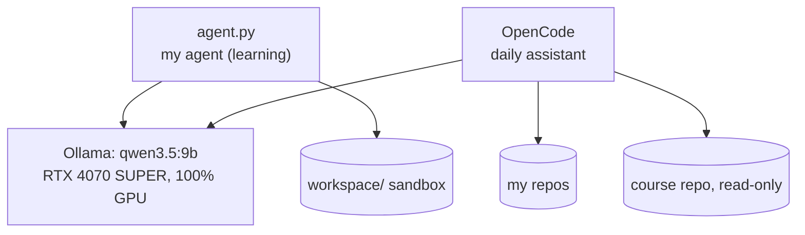
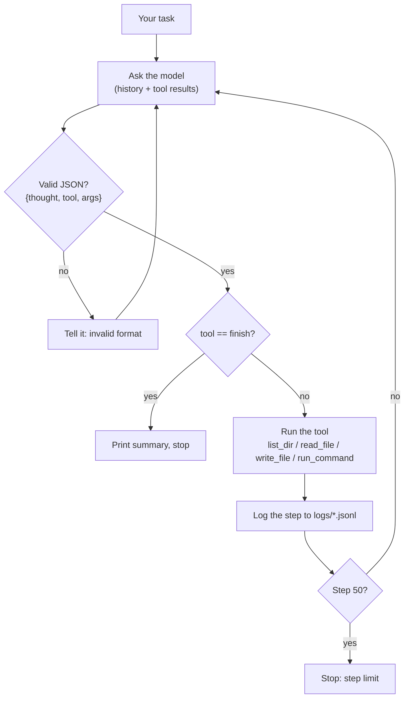

# localagent-lab

**Building a coding agent from scratch to learn how AI agents really work.** It runs fully on my own PC, with free open models only. Everything is measured, nothing is assumed.

The repo has two parts:

1. **`agent.py`: the agent I'm building**, in plain Python, one milestone at a time. It's the learning project.
2. **A ready-made local assistant ([OpenCode](https://opencode.ai))** for everyday help: questions, small code fixes, and explaining lessons from [ai-engineering-from-scratch](https://github.com/rohitg00/ai-engineering-from-scratch). Its config is in [`setup/opencode/`](setup/opencode).

Both use the same model, served by Ollama on the GPU.



## How `agent.py` works

The model never touches files itself. On each step it replies with **one JSON action**, and Python runs it:



Safety:
- Files are restricted to `./workspace`. Any path outside it is refused.
- Every shell command waits for **y/N** approval.
- Commands time out after 30 s.

## Quick start

From a **Windows** `cmd`, not WSL (why: [SETUP.md](docs/SETUP.md#troubleshooting)):

```bash
python agent.py
```

On startup it prints:

```
Model: qwen3.5:9b, num_ctx: 188416, max tool output: 188416 chars

Task (empty to quit):
```

Type a task, for example "write hello.py that prints hi, then run it". Each step shows the model's thought and the tool it calls.

To use another model, run `set AGENT_MODEL=gemma4:12b` first (`ollama pull` it before). For the daily assistant, run `opencode` in any folder.

Full PC setup, including Ollama settings, PATH, OpenCode and troubleshooting: **[docs/SETUP.md](docs/SETUP.md)**.

## What works (tested 2026-10-25)

| Feature | Status | Measured |
|---|---|---|
| Agent loop with 4 tools and `finish` | ✅ | "pelican SVG" task done in 3 steps, 32 s |
| JSON replies from qwen3.5:9b | ✅ | `think: false` fixed the empty-reply loops seen on Oct 21 |
| Sandbox (`workspace/`) and command approval | ✅ | |
| Per-step JSONL logs with latency | ✅ | `logs/<timestamp>.jsonl` |
| Automatic `num_ctx`: largest that fits 100% on GPU | ✅ | 8,192 → **188,416** tokens; binary search ~1 min, then cached |
| Whole files to the model; cut output is marked | ✅ | 106k-character file read in one piece, last line found |
| Ollama flash attention and `q8_0` cache | ✅ | 131k context: 9.95 GB spilling → 7.8 GB on GPU |
| OpenCode with the local model | ✅ | Course lesson explained in 14 s; clean 3-line edit on a step-by-step prompt |
| Tests | ✅ | 8 passing: `uv run pytest` (WSL) |
| Log summarizer `tools/summarize_log.py` | ⏳ | M1: empty, I write it myself |

Known limits:
- **Model size:** it's a 9B model. Great for focused tasks, weak at big multi-file changes, and it sometimes says "done" too early.
- **Context speed:** big contexts fill up as files are read, so steps get slower over a long run. One focused task per run works best.

## Milestones

| # | Milestone | Done when | Status |
|---|---|---|---|
| M0 | Setup | WSL, `uv`, git, `nvidia-smi`, `ollama list` work; a script prints a reply | ✅ 2026-10-13 |
| M1 | Python basics | CS50P weeks done; log summarizer with tests and type hints | ⏳ in progress |
| M2 | Talk to the model | Send a request, parse a JSON action | code exists |
| M3 | Tools | `list_dir`, `read_file`, `write_file` restricted to `workspace/` | code exists |
| M4 | The loop | A task done end to end; `run_command` needs approval | code exists |
| M5 | Logging | Every step saved to JSONL | code exists |
| M6 | Eval harness | 10 pytest tasks, one command prints a results table | |
| M7 | Better tools and safety | `replace_in_file`, step and time limits, sandbox | |
| M8 | Model comparison | 3 models × 2 prompts in a table | |
| M9 | Advisor mode | `profile.md`, `notes.md`, daily plan | |
| M10 | Decider experiment | One decision point replaced by a small model and compared | |
| M11 | Packaging | README, results, short demo | |

"Code exists" means a first version is in `agent.py`, but the milestone isn't signed off yet. Which course lessons go with each milestone: **[docs/CURRICULUM.md](docs/CURRICULUM.md)**.

## Layout

```
agent.py              the agent (loop, tools, model call, auto num_ctx)
tools/                helper scripts (M1: summarize_log.py)
tests/                pytest: logging, num_ctx search, output clipping
prompts/              saved system prompts (an old hackathon one)
docs/SETUP.md         full PC setup and troubleshooting
docs/CURRICULUM.md    milestone -> ai-engineering-from-scratch lessons
setup/opencode/       working OpenCode config and rules (copy to ~/.config/opencode)
claude-project/       instructions and context for my Claude mentor project
```

Not in git: `workspace/` (the agent's sandbox), `logs/` (run logs and the `num_ctx` cache), `.venv/`.

## Settings

| Variable | Default | What it does |
|---|---|---|
| `AGENT_MODEL` | `qwen3.5:9b` | Ollama model to use |
| `AGENT_NUM_CTX` | auto | Force a context size instead of measuring |
| `OLLAMA_URL` | `http://localhost:11434/api/chat` | Where Ollama is |
