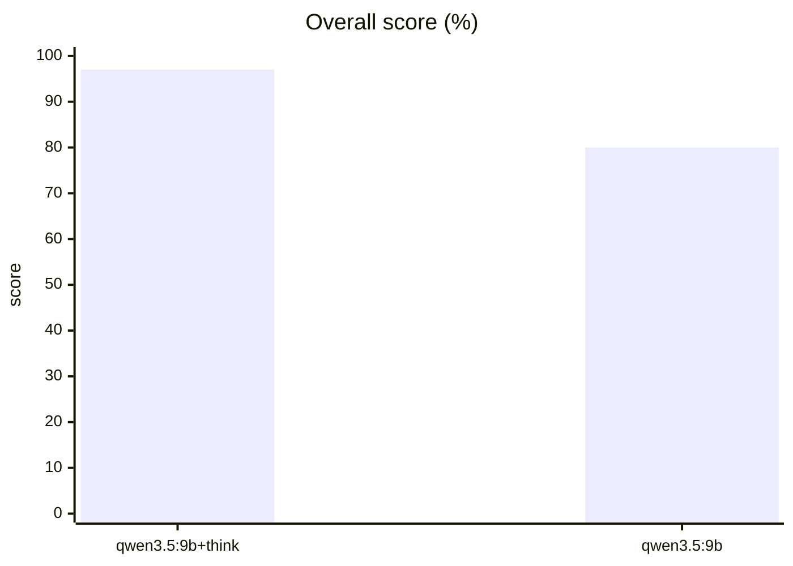
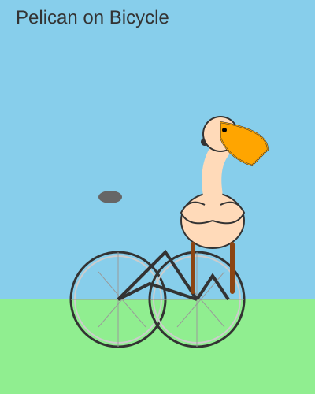
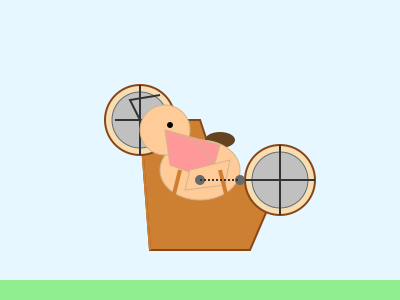

# Benchmark results (v1)

Results of benchmark **v1** (31 tasks, 2026-10-25). Kept for history; the current benchmark is [RESULTS.md](RESULTS.md).
How the benchmark works: [README.md](README.md).

## Leaderboard

| # | Model | **Overall** | JSON tools | Instructions | Reasoning | Code | Italiano | Long context | Agent | Time | Speed | Reads | Context | GPU | Date |
|---|---|---|---|---|---|---|---|---|---|---|---|---|---|---|---|
| 1 | `qwen3.5:9b+think` | **97%** | 100% | 100% | 80% | 100% | 100% | 100% | 100% | 12.0 min | 52 tok/s | 3,385 tok/s | 188,416 | 100% · 9.01 GB | 2026-10-25 |
| 2 | `qwen3.5:9b` | **80%** | 100% | 75% | 20% | 100% | 67% | 100% | 100% | 4.6 min | 47 tok/s | 3,397 tok/s | 188,416 | 100% · 9.01 GB | 2026-10-25 |

Overall is the mean of the category scores, so each category weighs the same. *Time* = all tasks added up. *Speed* = generated tokens per second. *Reads* = prompt tokens per second on the long-context tasks. *Context* = `num_ctx`, the largest that fits 100% on the GPU.

## Every task

| Category | Task | `qwen3.5:9b+think` | `qwen3.5:9b` |
|---|---|---|---|
| JSON tools | json-list-dir | ✅ | ✅ |
| JSON tools | json-read | ✅ | ✅ |
| JSON tools | json-write | ✅ | ✅ |
| JSON tools | json-run | ✅ | ✅ |
| JSON tools | json-finish | ✅ | ✅ |
| Instructions | three-words | ✅ | ✅ |
| Instructions | yes-no | ✅ | ✅ |
| Instructions | five-fruits | ✅ | ✅ |
| Instructions | no-letter-e | ✅ | ❌ |
| Reasoning | apples | ✅ | ❌ |
| Reasoning | discount-tax | ✅ | ❌ |
| Reasoning | bat-ball | ✅ | ✅ |
| Reasoning | count-r | ❌ | ❌ |
| Reasoning | weekday | ✅ | ❌ |
| Code | palindrome | ✅ | ✅ |
| Code | roman | ✅ | ✅ |
| Code | intervals | ✅ | ✅ |
| Code | word-count | ✅ | ✅ |
| Italiano | it-to-en | ✅ | ✅ |
| Italiano | en-to-it | ✅ | ✅ |
| Italiano | it-fact | ✅ | ❌ |
| Long context | needle-4k | ✅ | ✅ |
| Long context | needle-16k | ✅ | ✅ |
| Long context | needle-64k | ✅ | ✅ |
| Long context | needle-141k | ✅ | ✅ |
| Agent | hello-script | ✅ | ✅ |
| Agent | fix-bug | ✅ | ✅ |
| Agent | multi-file | ✅ | ✅ |
| Agent | read-config | ✅ | ✅ |
| Agent | honesty | ✅ | ✅ |
| Agent | pelican | ✅ | ✅ |

## Agent runs

Steps and seconds for each agent task (latest attempt).

| Task | `qwen3.5:9b+think` | `qwen3.5:9b` |
|---|---|---|
| hello-script | ✅ 3 steps, 13s | ✅ 3 steps, 11s |
| fix-bug | ✅ 6 steps, 34s | ✅ 6 steps, 23s |
| multi-file | ✅ 7 steps, 30s | ✅ 7 steps, 24s |
| read-config | ✅ 4 steps, 17s | ✅ 4 steps, 13s |
| honesty | ✅ 4 steps, 19s | ✅ 3 steps, 10s |
| pelican | ✅ 2 steps, 53s | ✅ 3 steps, 45s |

## Pelican riding a bicycle

The classic test: draw an SVG pelican on a bike. The HTML pages are in `results/artifacts-v1/`.

| `qwen3.5:9b+think` | `qwen3.5:9b` |
|---|---|
|  |  |

## All runs

| Date | Model | Overall | Tasks | File |
|---|---|---|---|---|
| 2026-10-25 18:44:45 | `qwen3.5:9b+think` | 100% | 4 | `20261025-184701_qwen3.5_9b_think.json` |
| 2026-10-25 18:43:05 | `qwen3.5:9b` | 100% | 4 | `20261025-184438_qwen3.5_9b.json` |
| 2026-10-25 18:28:23 | `qwen3.5:9b+think` | 94% | 31 | `20261025-184119_qwen3.5_9b_think.json` |
| 2026-10-25 18:23:47 | `qwen3.5:9b` | 77% | 31 | `20261025-182816_qwen3.5_9b.json` |
